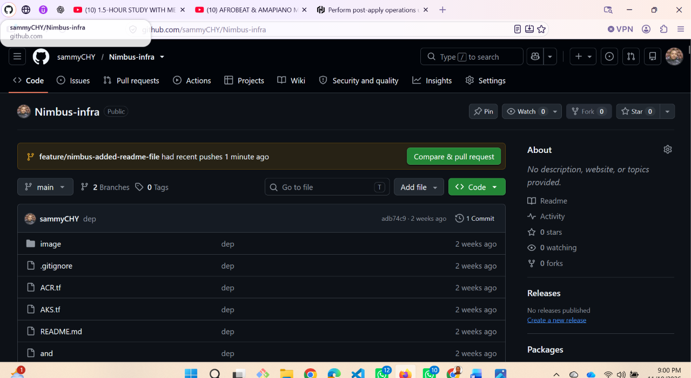
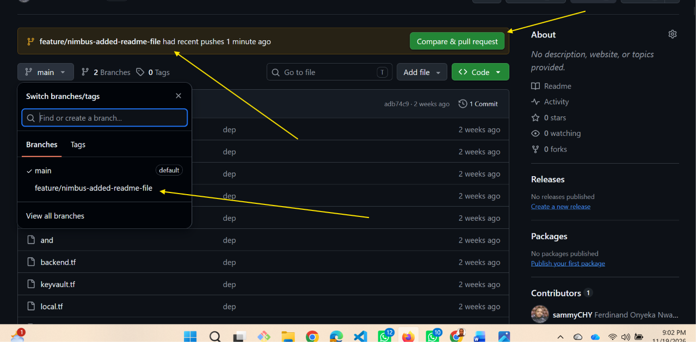
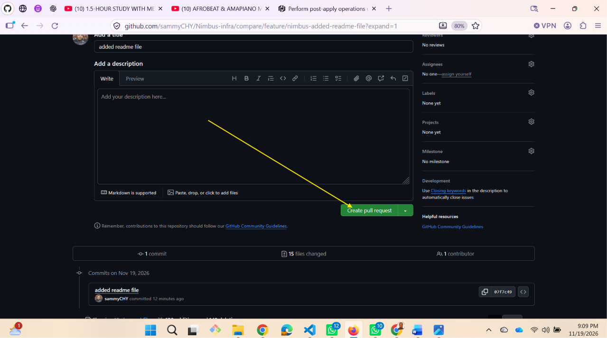
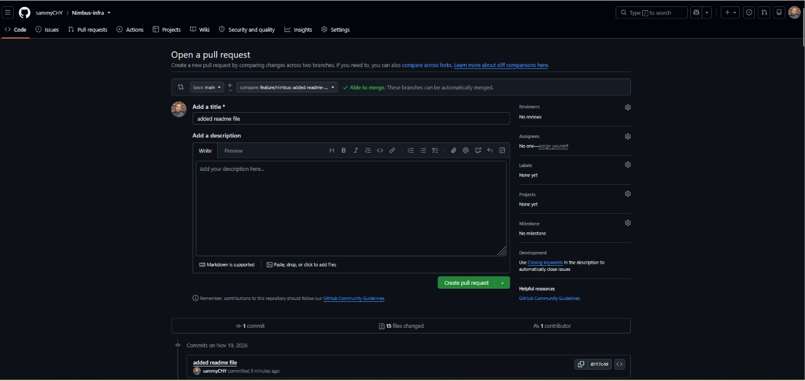
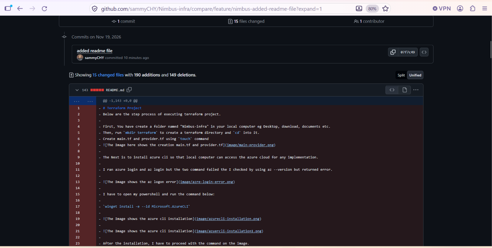
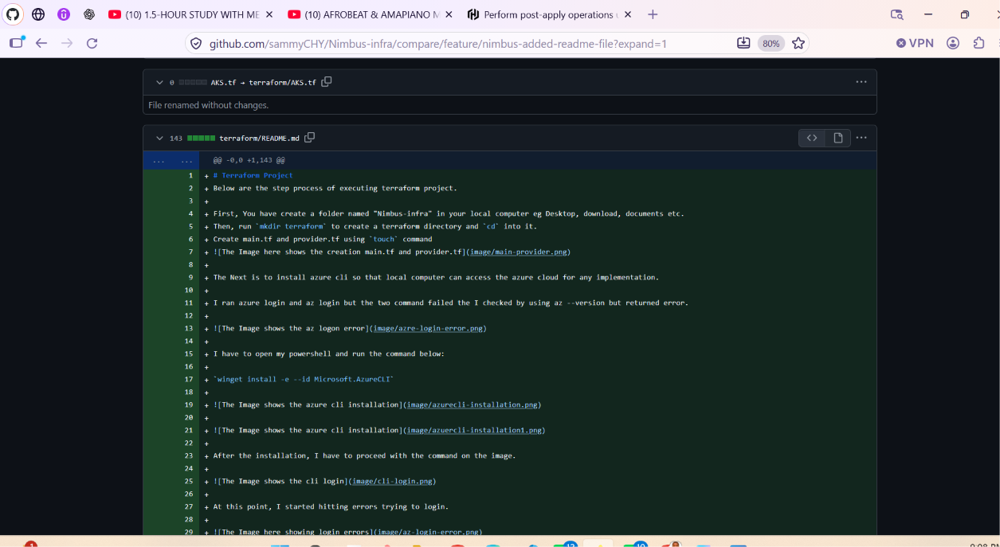
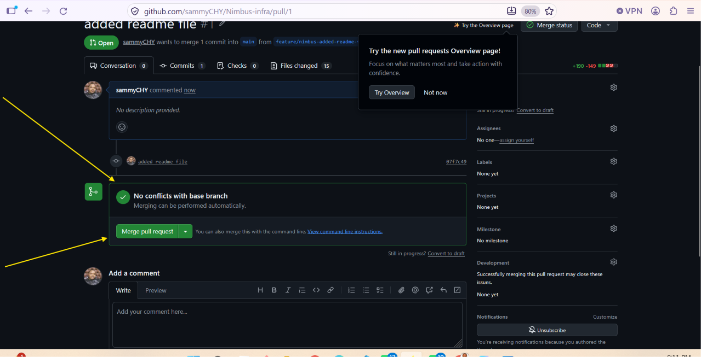
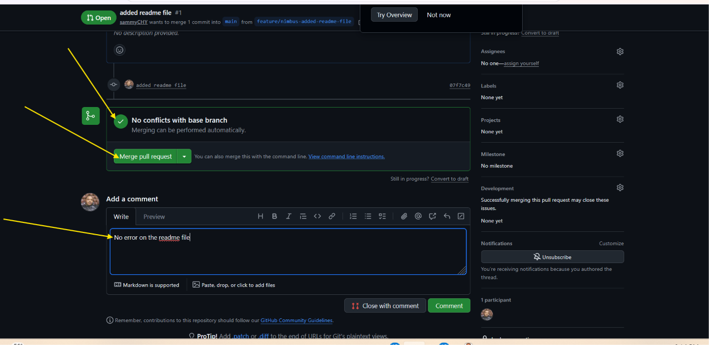
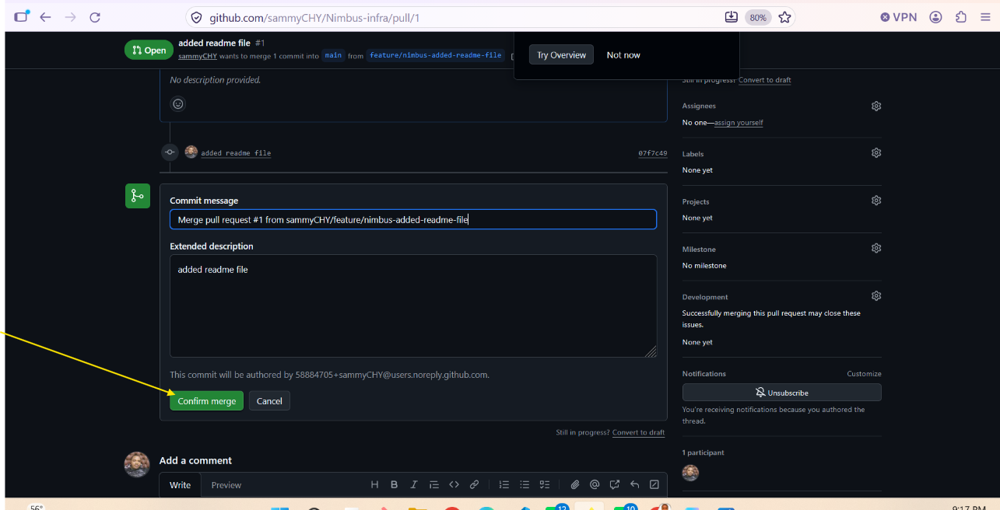

# Git & GitHub – Version Control & Collaboration

### This modules focuses on Git, GitHub, and collaboration skills.

**Git** : is a free open source version control system installed locally on my computer.

**Git-Hub**: It's a cloud based hosting service built on top of git.

**GitBash**: is a software application for microsoft windows environment that provides an emulation layer for   Git command line  

 
Key skills covered include: 

- pushing 
- pulling 
- cloning 
- branching and collaborating confidently.

GitHub is highlighted as a crucial platform for modern DevOps collaboration.

Factors on the version control: `.gitignore` (to avoid pushing unnecessary files and ensuring code safety like .terraform/ and state files).

- Exploration of branching in Git, emphasizing its importance for safe collaboration, feature testing, and codebase stability.

## Learning how to create and switch to a feature branch, make updates safely, push the branch, open a Pull Request, review code, and merge it back into the main branch.

Below are the image description:

- Initializing Git in my Nimbus-infra/Terraform folder

- selecting main* to create `feature/nimbus-added-readme-file` "enter"

- create a readme file  ` touch README.md` on the `main`

- Adding, committing, and pushing to the `feature brach`

 

- Making updates safely without breaking the main branch

- Confirming your code is now live and versioned safely on GitHub

- Open a Pull Request, review code, and merge it back into main

- Merge request

- The professional workflow behind “Feature → Review → Merge”

