# Linux Essentials for DevOps.

1. Print the present working directory.

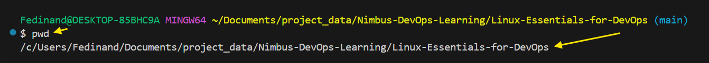

2. Create a directory named 'advanced _directory or anything' and navigate into it.

3. Create two files, "file_a.txt" and "file_b.txt" in the linux_Essential directory and list them with detailed information.

- Run the commands below to create the two files.

` touch file_a.txt file_b.txt`

Run  `ls -l` to view the files and directories, detailed information including permissions, owner, file size, and modification date.

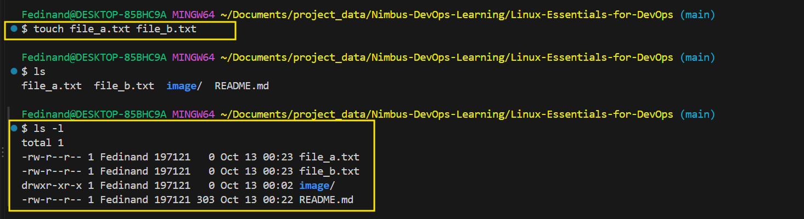

4. Create a symbolic link to "fila_a.txt" named "link_to_file_a" in the same directory.

Below is the command to create symbolic link in Linux.

`ln -s`

I have run `ln -s file_a.txt link_to_file_a` this create a symbolic link named `link_to_file_a` pointing to `file_a.txt` in the same directory.

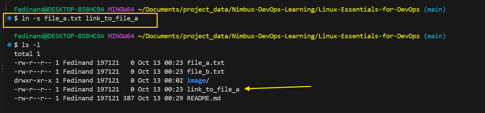

5. Change the permissions of "file_b.txt" to make it readable, writable, but not executable by the owner, and read-only for others.

To execute this task `chmod` command to be used to change the permission of file `file_b.txt`.

Run the command below to execute.

`chmod 644 file_b.txt`

This set the permission as follows:

User Category       Permission                  Numeric Value

1. Owner        Read and write (`rw-`)              6

2. Group        Read only (`r--`)                   4

3. Others       Read only (`r--`)                   4

The owner does not have execute permission, and neither the group not other can write to or execute the file.

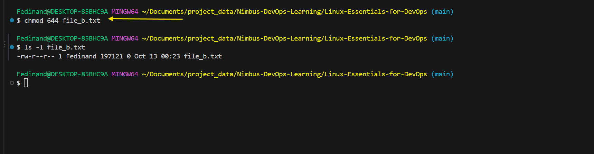

*********************************************************************************************************************

6. Create a new directory "nested_directory" and "present-working directory" and copy both file_a.txt and file_b.txt into it.

run `mkdir nested_directory`

Then, run `cp file_a.txt file_b.txt nested_directory/`

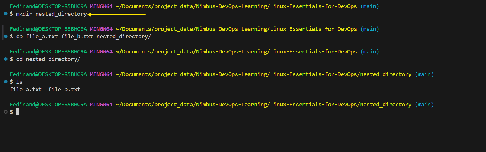

7. Navigate into "nested_directory" create a new file named "secret.txt" and write "Hello world!" into it use a single command.

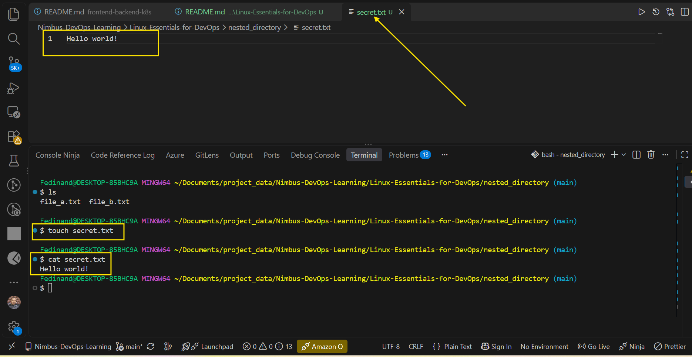.

8. Move `file_a.txt` and `file_b.txt` from "nested_directory" back to "present-working-directory" using one command.

Run the command below:

`mv nested_directory/file_a.txt nested_directory/file_b.txt .`

9. Return to "Linux-Essentials/Present working directory" and create a `.hidden_file.`

run: `touch .hidden_file`

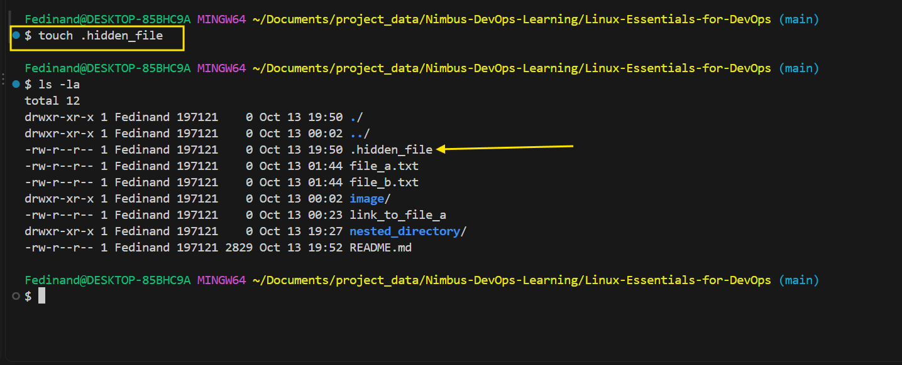

10. List all files (including hidden ones) in "present_working_directory" with human-readable file sizes.

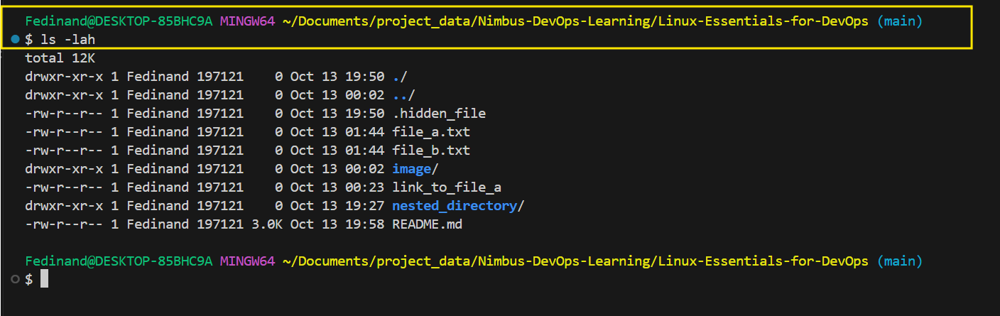

11. Create a new directory "backup" and archive("tar") all files in "Linux-Essential-for DevOps" (including hidden files) into "backup/archive.tar".

1. Create a directory called `backup`.
2. Take everything inside `Linux-Essentials-for DevOps`, including hidden files.
3. Put all of it into a TAR archive called `archive.tar`.
4. Store that archive inside `backup`.

Run:

`mkdir backup` 

`tar -cvf backup/archive.tar .`

Let me break it down.

- `tar`  archive utility
- `-c`   Create a new archive
- `-v`   Verbose, show files being archived
- `-f`   specify the archive fileman
- `backup/archive.tar`
- . archive everything in the current directory.

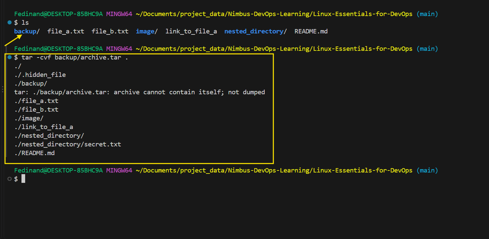

12. Extract the contents of `archive.tar` into a directory named `restore`.

Run:

`mkdir restore`

`tar -xvf backup/archive.tar -c restore`

- `-x`  extract the archive
- `-v` show the files being extracted
- `-f`  specify the archive file
-  `backup/archive.tar`    my archive
-  `-c restore`  extract the contents into `restore`

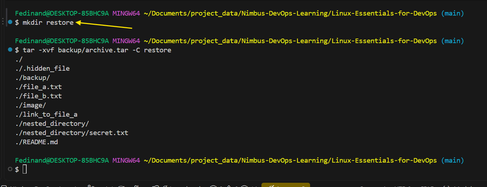

13. Create a new file `temp.txt`, then create a hard link to it named `hard_link_to_temp`.

Run the command below to create `temp.txt` file.
`touch temp.txt`

Followed

`ln temp.txt hard_link_to_temp`

To verify the hard link

`ls -li temp.txt hard_link_to_temp`

The number shown in the image below is the `inode number`. The matching inode numbers confirm that `temp.txt` and `hard_link_to_temp` are hard links to the same file.

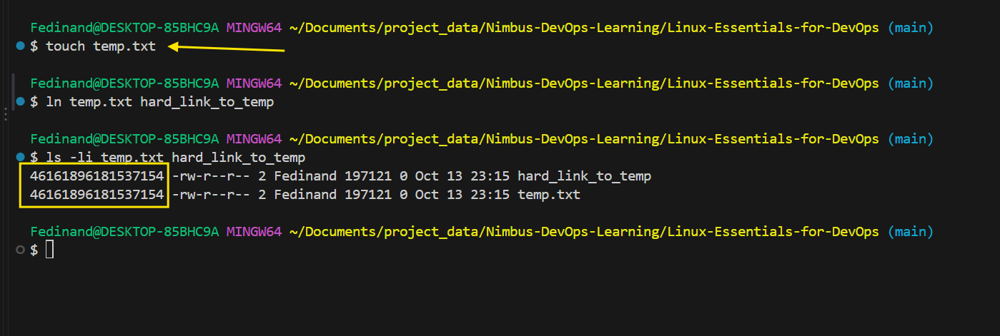

14. Find all `.txt` files within `Linux-Essentials-for-DevOps` and it's subdirectories and display their paths.

Run the command below:
`find . -type f -name "*.txt"`

- `find .`
- Start searching from the current directory (`.`)
- `-type f`  only find files, not directories.
- `-name "*.txt"` only find files whose names end with `.txt`

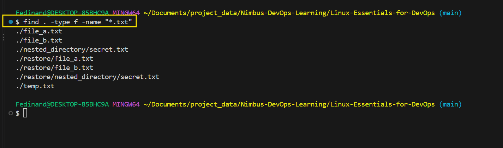

15. Delete the `backup` directory and its contents, then delete all `txt` files in the `restore` directory using one command.

Run the command below:

`rm -r backup && find restore -type f -name "*.txt" -delete`

- rm -r backup — deletes the backup directory and all its contents.

- && — runs the next command only if the first succeeds.

find restore — searches inside the restore directory.

- -type f — selects files only.

- -name "*.txt" — matches files ending in .txt.

- -delete — deletes the matching files.

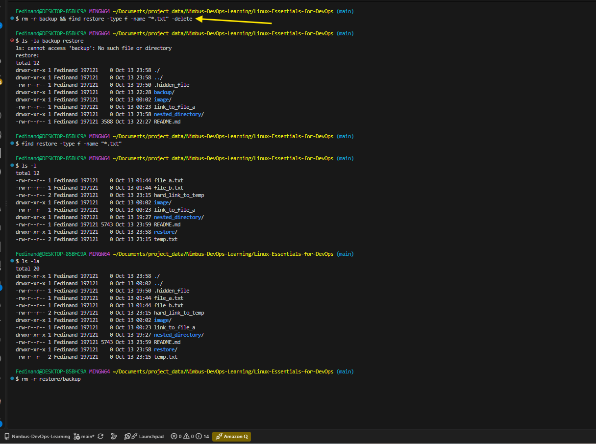

16. Create a symbolic link in `linux-Essentials-for-DevOps` that points to the `restore` directory.

Run the command below:

`ln -s restore restore_link`

The command creates symbolic link named restore link named `restore_link` that point to restore directory.

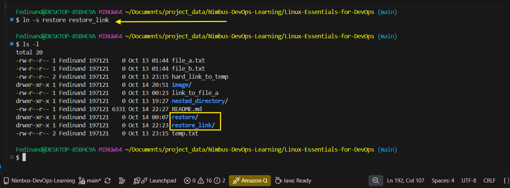

17. Find all files modified in the last 7 days in `linux-Essentials-for-DevOps` and its subdirectories.

Run the command below:

`find . -type f -mtime -7`

which means `find .`  find **files only** not directories.

`-mtime -7`

- Find files modifies within the last 7 x 24 hours.

This will produce all the image below.

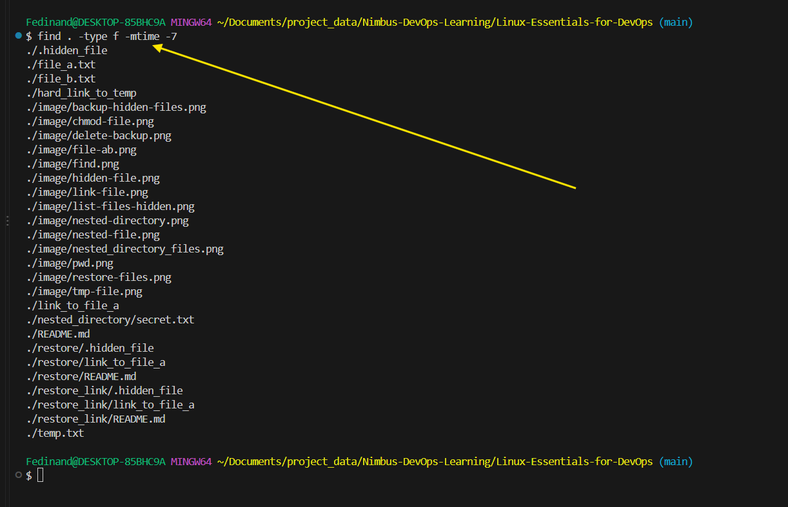

18. Search for the string "Hello World" in all `.txt` files inside `linux-Essentials-for-DevOps` and its
subdirectories.

Run the command below:

`grep -Rnl --include="*.txt" "Hello World" .`

- `grep`: search for txt inside files.

- `-R` : Searches recursively, meaning the current directory and all its subdirectories.

- `-n` : Shows the **line number** where the txt is found.

- -l : Shows only the file names that contain the text.

`--include="*.txt"`

`"Hello world!"` : The exact string we're looking for.

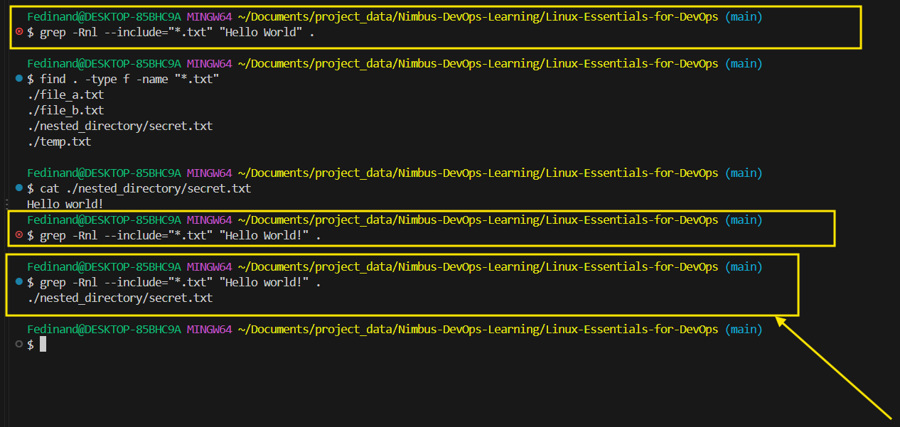