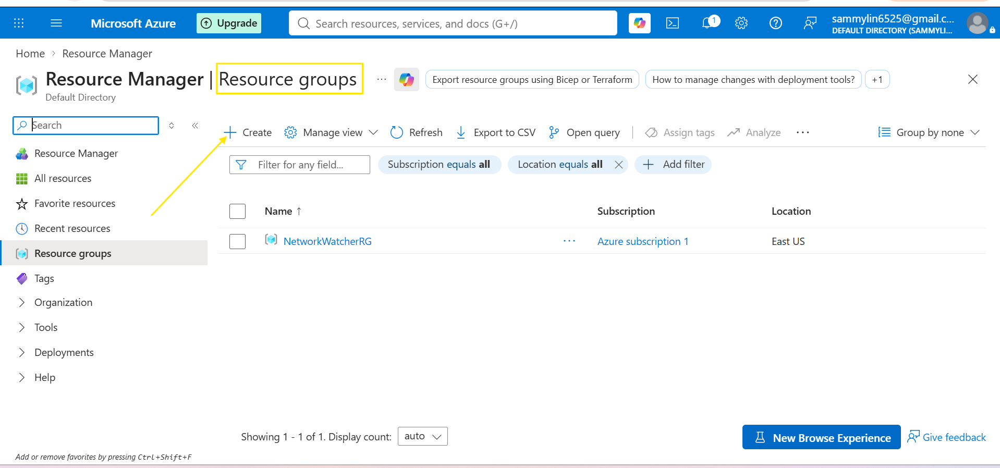
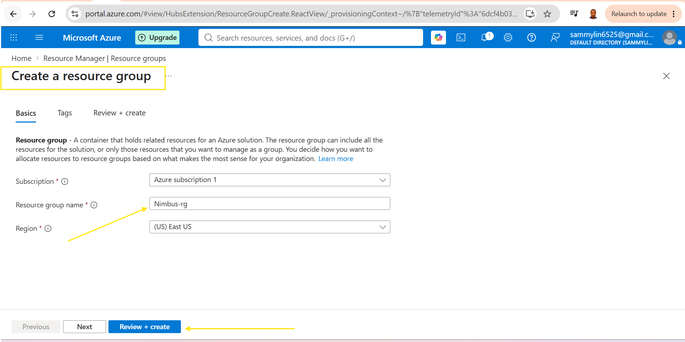
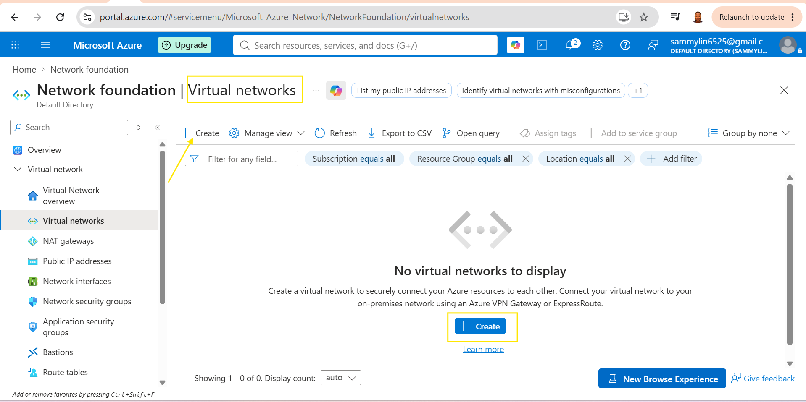
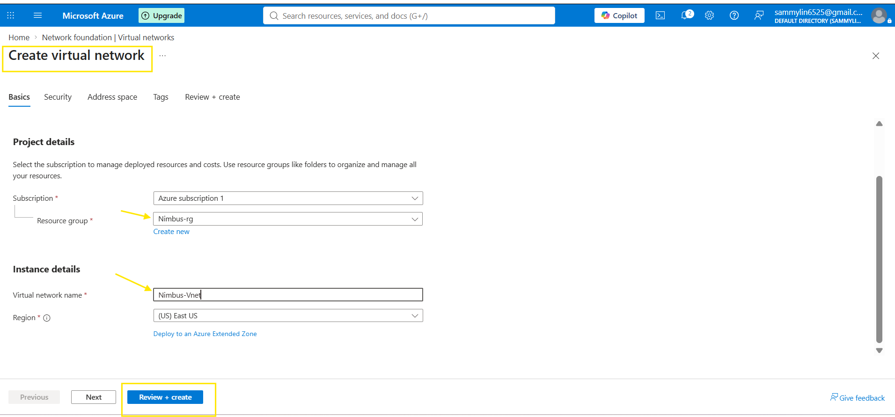
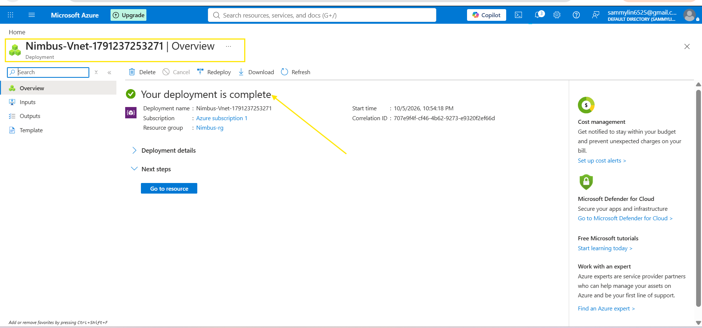
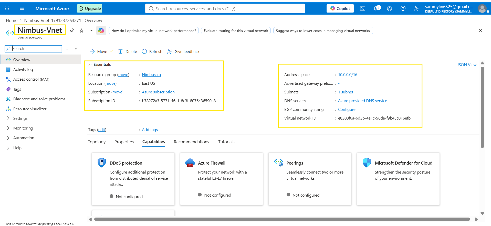
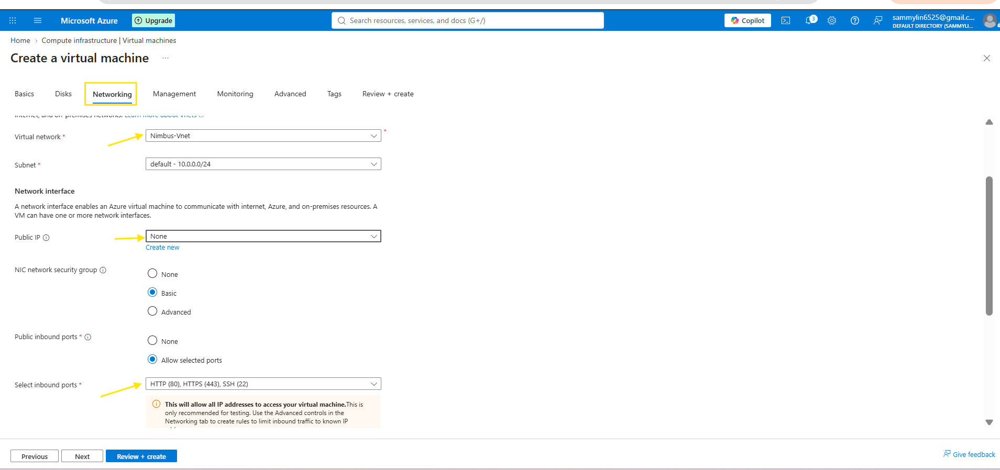
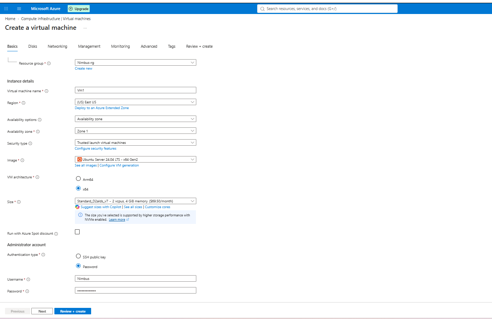
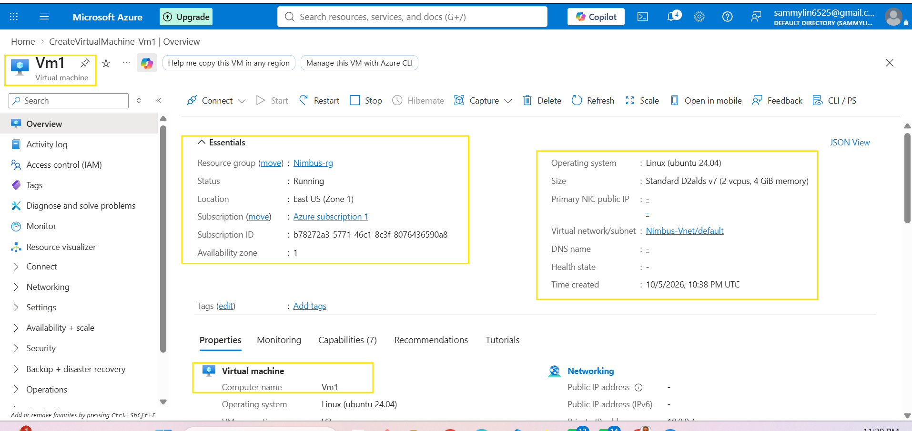

# Deploying Azure Networking Project.

In this project we are going to deploy two ***linux VM*** inside thesame Azure Virtual-Network connect and secured using Azure Bastion and Ping between then to confirm network connectivity, this is exactly how enterprises manage it.

I have to review and create

2. Create virtual Network. search for virtual network in the search box and select then create new virtual network

The Image below show the creation of virtual network

After the creation of the resources click "go to resources"

3. Creation of Virtual machine by selecting from the search box.

4. The next the creation of two virtual machine named VM1 and VM2 

At this point all the two vm's has been created which are vm1 and vm2
The next is to ssh into vm1 and ping vm2 linux.

Go into the vm2 and copy the private IP address, the select vm1 and connect via bastion
Then ssh into the vm1 using the bastion  after the connection via ssh then ping.

The 5th project.